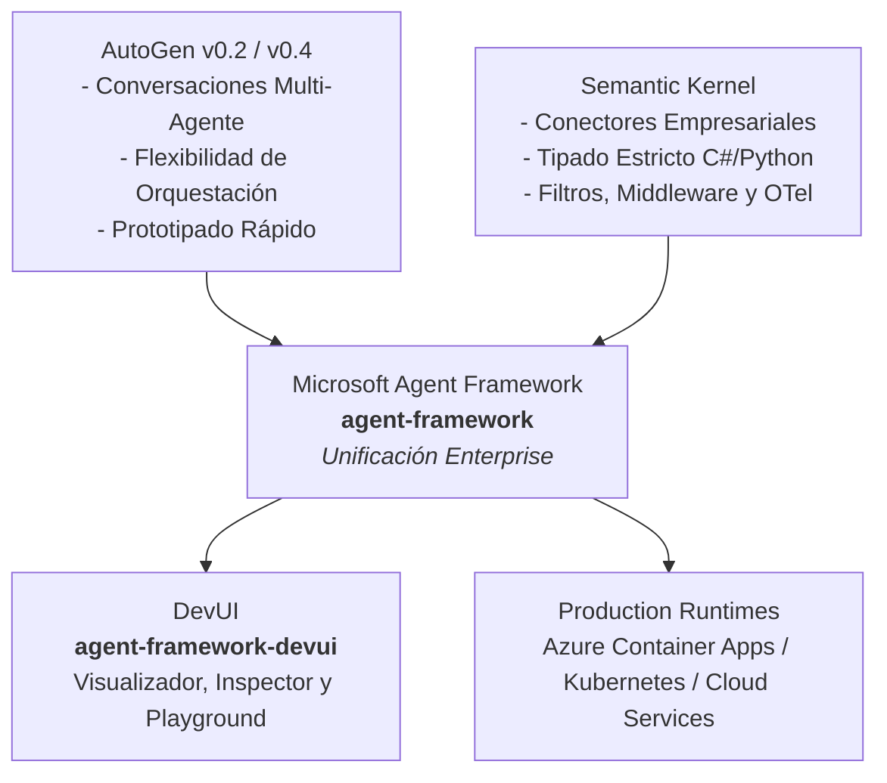
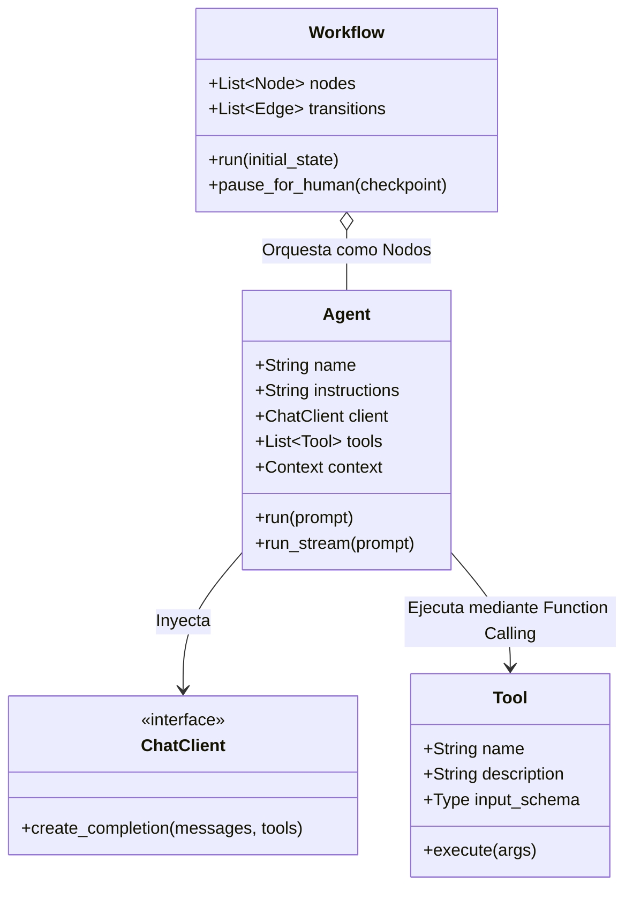
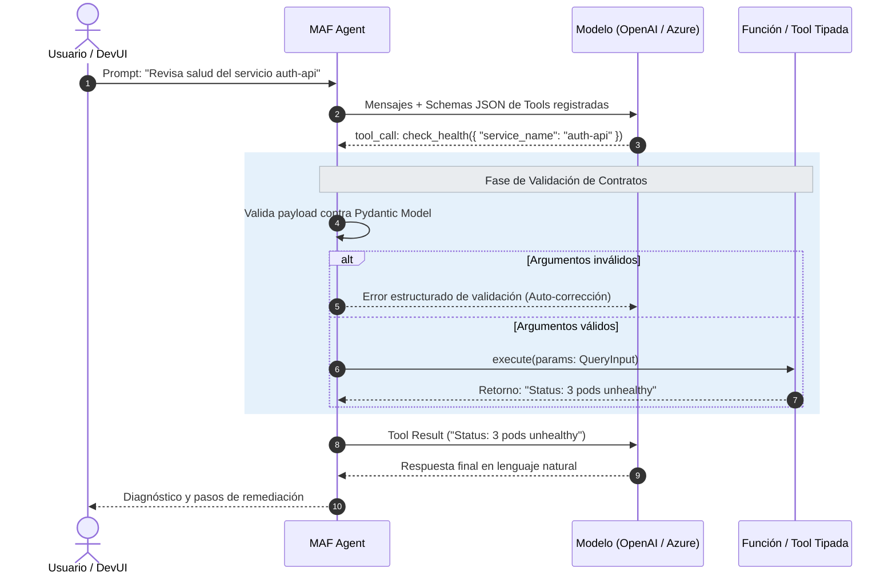
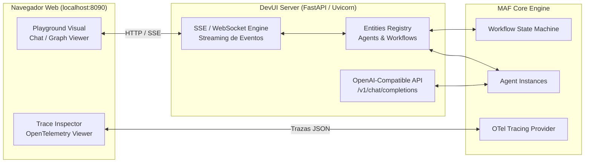
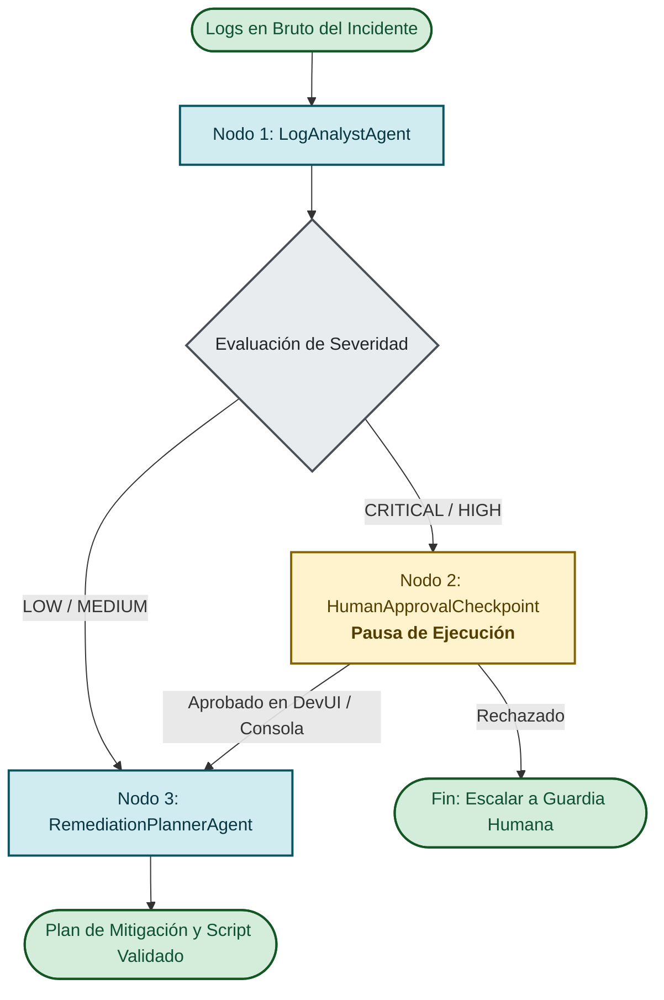

# 🏛️ Arquitectura del Microsoft Agent Framework (MAF)

Este documento detalla la base arquitectónica y los conceptos de diseño de **Microsoft Agent Framework** y su entorno de desarrollo visual **DevUI**.

---

## 1. Contexto y Evolución del Ecosistema Microsoft

Hasta principios de 2025/2026, el ecosistema de IA generativa de Microsoft presentaba dos vertientes complementarias pero divididas:

* **AutoGen (legado):** Excelente para dinámicas conversacionales y prototipado multi-agente, pero con dificultades para control determinista y gobierno corporativo.
* **Semantic Kernel (legado):** Excelente para integración empresarial, filtros, plugins y contratos de software, pero con abstracciones multi-agente más rígidas.
* **Microsoft Agent Framework (MAF):** La **unificación oficial y estable**. Combina el modelo de orquestación flexible de AutoGen con la robustez arquitectónica, tipado estricto, observabilidad (OpenTelemetry) y middleware de Semantic Kernel.

---

## 2. Componentes Nucleares de la Arquitectura

### 2.1. El Agente como Actor Dirigido por Eventos
Para un ingeniero de software tradicional, un `Agent` en MAF no es una función aislada, sino un **Actor con estado**:
1. **Receptor de Mensajes:** Acepta entradas en un buffer o cola de contexto.
2. **Bucle de Inferencia (*Reasoning Loop*):** Decide si responde directamente con texto o si invoca una o más herramientas en paralelo o secuenciales.
3. **Despacho de Herramientas (*Tool Dispatcher*):** Valida los argumentos recibidos mediante esquemas JSON generados por reflexión a partir de tipos de Python (`pydantic` o `typing`).
4. **Emisión de Eventos:** Publica eventos estructurados (`AgentRunStarted`, `ToolCallInvoked`, `ToolCallResult`, `AgentRunCompleted`) que pueden ser consumidos por observadores o por **DevUI**.

---

## 3. Ciclo de Vida del *Tool Calling* y Validación de Contratos

Uno de los mayores riesgos en aplicaciones de IA es el comportamiento no determinista de los argumentos de entrada. MAF mitiga esto forzando contratos tipados:

---

## 4. Arquitectura de DevUI (`agent-framework-devui`)

**DevUI** actúa como un *Harness* de pruebas local sin requerir que el equipo construya un frontend React o Angular para validar los agentes.

### Capacidades Clave de DevUI:
1. **Descubrimiento Automático o Programático:** Registra agentes y flujos en memoria mediante `serve(entities=[...])` o escaneando un directorio.
2. **Visualización de Grafos de Trabajo:** Despliega los nodos de un `Workflow` indicando en tiempo real el nodo activo, las transiciones y los payloads transferidos.
3. **Pausa para Intervención Humana (HITL):** Cuando un flujo entra en estado de espera (*Human Approval*), la interfaz presenta un modal de confirmación con los argumentos propuestos antes de permitir que el workflow continúe.
4. **Backend Compatible con OpenAI:** Expone el endpoint `/v1/chat/completions`, lo que permite probar el agente desde herramientas estándar como `curl`, Postman o tests automatizados sin alterar el código.

---

## 5. Arquitectura del Flujo del Laboratorio 3 (Pipeline con HITL)

En [GUIA_LABORATORIOS.md](./GUIA_LABORATORIOS.md), implementamos este patrón de arquitectura empresarial:

### Principios de Ingeniería Aplicados:
* **Inmutabilidad y Paso de Estado:** Cada nodo recibe una instantánea del estado del incidente y retorna una copia actualizada con su resultado.
* **Idempotencia:** Las herramientas de diagnóstico son de solo lectura; las acciones de modificación están aisladas detrás del nodo de aprobación.
* **Separación de Responsabilidades:** El analizador de logs no conoce cómo remediar; el planificador de remediación no analiza logs sin procesar, solo consume el diagnóstico estructurado.
